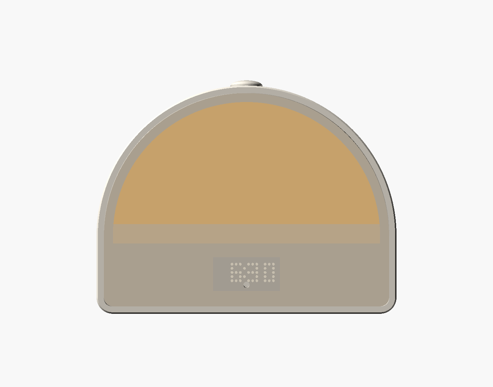
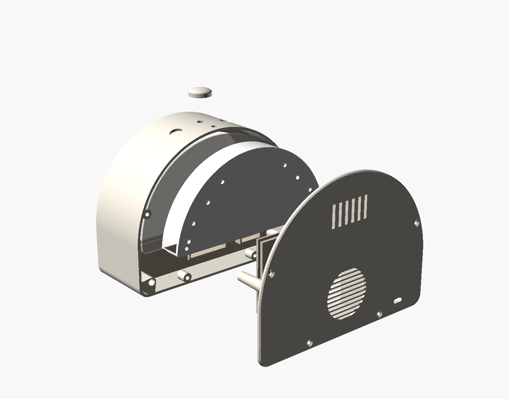

# Enclosure

It's modelled on the Hatch sleep clocks:
- an arch-shaped body with a thin rim;
- a linen-covered front that glows above a soft "horizon";
- a dot-matrix clock showing through the fabric below the glow;
- a low dome knob on top.

The outside is **184 W × 140 H × 72 D mm**. The front matches the Hatch Restore (7.24 in wide). It is 10 mm deeper than Hatch's 62 mm, because the rear-facing speaker has to sit behind the 20 mm light gap.

`sunrise_clock.scad` is fully parametric: every size below is a variable at the top of the file.





## Parts

```
 front                                                                              back
   ┌────────┐ ┌────────┐ ┌──────────┐ ┌──────────────┐ ┌──────────┐ ┌──────────────────────┐
   │ SHELL  │ │ FRAME  │ │ DIFFUSER │ │  LIGHT BOX   │ │ SPEAKER  │ │     BACK COVER       │
   │ arch,  │ │ linen  │ │ white    │ │ LED plate,   │ │ LID      │ │ speaker chamber,     │
   │ 1.6 mm │ │ wraps  │ │ PETG,    │ │ 4 strip rows,│ │          │ │ grille, USB-C, vents,│
   │ rim,   │ │ it;    │ │ dome     │ │ walls +      │ │          │ │ devkit standoffs,    │
   │ top    │ │ clock  │ │ shape    │ │ horizon      │ │          │ │ 2 posts that hold    │
   │ knob + │ │ sleeve │ │          │ │ baffle       │ │          │ │ the light box        │
   │ buttons│ │        │ │          │ │              │ │          │ │                      │
   └────────┘ └────────┘ └──────────┘ └──────────────┘ └──────────┘ └──────────────────────┘
      ▲ everything goes in from the back, behind the rim; the back cover closes it with 4 screws

 Depth (y, mm from the front face):
   0-1.6 rim lip   1.6-2.2 fabric   2.2-5.4 frame (diffuser in its back 3.4-5.4)
   5.4-25.4 light gap   25.4-27.9 LED plate   31-69 speaker chamber   69-72 back cover
```

How the front works:
- Linen is wrapped around the frame's edge and glued on its back. The frame then sits behind the 1.6 mm rim lip, so the rim hides the fabric edge. It is held by 2 M3 screws at its lower corners, driven from behind into the shell's corner bosses.
- The diffuser covers the upper dome and press-fits into a pocket in the frame's back. That's 0.5 mm clearance, with 5 crush ribs reaching 0.1 mm past it. The light box's rim then backs it up.
- The light box keeps the light in the dome. Its bottom wall (the horizon baffle) stops 8 mm short of the diffuser, so light spills under it into a soft fade, as on the original. The LED face is exactly 20 mm behind the diffuser.
- The clock module pushes into the sleeve on the frame's back, with its LEDs right against the fabric so the dots stay sharp.
- The sleep radar (HLK-LD2410C) sits in a second pocket on the frame's back, at lower left. There is no hole: 24 GHz goes through the 3.2 mm frame and the linen. Its antenna faces forward, with the LEDs, clock and speaker magnet all beside or behind it.

## Print

**Bambu Studio (A1):** open [`sunrise_clock_A1.3mf`](sunrise_clock_A1.3mf). It has all 7 parts on 3 plates, with filament 1 = white PLA and filament 2 = black PLA, on standard 0.20 mm settings. The diffuser is set to 100 % infill, and the parts that take heat-set inserts get 4 walls.
1. White: shell, diffuser, knob
2. White: back cover, light box, speaker lid
3. Black: frame

If you change the model, rebuild it with `python make_3mf.py`, after `build.py`.

| Part | Orientation (as exported) | Notes |
|---|---|---|
| `shell.stl` | back rim down | 0.2 mm, 4 perimeters, **no supports**. The corner screw columns rise straight from the bed. The only overhang is the 2.1 mm rim lip at the top, which prints fine as it is. |
| `frame.stl` | face down | **Dark** filament, so the area below the horizon stays dark through the fabric |
| `diffuser.stl` | flat | **White PETG**, 2 mm, 100 % infill. Or laser-cut 2 mm opal acrylic from the STL outline. |
| `light_box.stl` | LED plate down | White, so it reflects forward |
| `back_cover.stl` | outside face down | Same colour as the shell |
| `speaker_lid.stl` | lip down | Seal the edge and the wire hole with glue |
| `knob.stl` | flat side down | Same colour as the shell |

Every part fits a 220 × 220 mm bed (largest footprint 184 × 140 mm).

## Hardware

- **Fabric:** about 200 × 160 mm of thin, loosely woven linen or linen-look fabric. Hold it up to a bulb first: it should glow warm, not block the light.
- **LED strip:** 40 × WS2812B at **96 or 100 LED/m**, 10 mm wide, cut into rows of 13, 12, 9 and 6 LEDs. The rows are generated from `led_count` / `led_per_m`, and the model refuses settings that don't fit. 60 LED/m fits only ~29 LEDs in this dome.
- **Clock:** Adafruit 0.8" 8x16 LED Matrix FeatherWing (HT16K33, 40.6 × 20.3 mm of LEDs). Its LEDs sit in a 3 mm locating rim on the frame, with the wider board behind. Warm white looks closest to the original.
- **Sleep radar:** HLK-LD2410C (22 × 16 mm; the pocket is set by `radar_size`, so measure yours).
- **Inserts:** 8 × M3 heat-set (Ø4.0 hole, 5 mm): 2 in the frame, 4 in the shell's back bosses, 2 in the light-box posts. Add 4 more for the devkit standoffs.
- **Screws:**
  - 2 × M3×10 countersunk (frame; no longer, or they push through the frame face)
  - 2 × M3×6 countersunk (light box)
  - 4 × M3×8 countersunk (back cover)
  - 4 × M3×6 for the devkit board (holes 22 × 60 mm)
- **Controls:** EC11 encoder (nut on the M7 bushing) under the knob, and 2 × 12 mm panel-mount momentary buttons. All three holes are square to the curved top.
- **Other:**
  - 4 rubber feet, Ø ≤ 11 mm
  - 2" (51 mm) 4 Ω 3 W speaker (Gikfun EK1725); for another size, set `spk_d`
  - USB-C 5 V breakout, glued behind its slot

## Assembly

1. Press the heat-set inserts in: frame corners, shell back bosses, light-box posts, devkit standoffs.
2. Cut the linen about 15 mm larger than the frame all round. Stretch it over the front, wrap it round the edge and glue it on the back. Cut the window corners so it lies flat, and keep the clock window and the two corner inserts clear.
3. Press the diffuser into the frame's back. Push the clock module into its sleeve, and the radar into its pocket with the antenna side toward the fabric. Secure each with a dab of hot glue, keeping the glue off the radar's antenna.
4. Drop the frame into the shell from behind, fabric first. Screw its two lower corners down through the corner columns: the screws go in from the open back, and a long 2 mm hex key reaches the countersunk seat.
5. Fit the encoder, buttons and BH1750 (under the small top hole) into the shell.
6. On the back cover:
   - glue in the speaker and press on the chamber lid;
   - mount the devkit board on its standoffs; glue the USB-C breakout behind its slot.
7. Stick the 4 strip rows into the light-box channels. Data enters at the left end of the bottom row. Bridge each row end to the next through the holes, using short wires on the back. Screw the light box onto the two back-cover posts.
8. Connect the LEDs, clock, radar and top controls to the board. Lower the back cover in so the light box's rim seats on the diffuser, and fit the 4 back screws.

## Re-export and check

```bash
python enclosure/build.py
```

The script exports each STL into `stl/` in print orientation, then checks:
- every mesh is closed and edge-manifold, with positive volume;
- every part fits the bed;
- the assembled parts don't intersect (OpenSCAD intersection of every pair that meets);
- it re-renders `front.png` and `exploded.png`.

`python enclosure/overhangs.py` lists every surface that faces the bed at more than 45° in print orientation, so you can see what needs support. Nothing here does.

Latest run (frame / diffuser is the intended crush-rib press fit; every other pair is clear):

```
shell          8002 tris   184.0 x  140.0 x   69.0 mm    112.6 cm3  manifold: yes  bed: fits
frame          3072 tris   177.0 x  133.0 x   11.2 mm     24.2 cm3  manifold: yes  bed: fits
diffuser        908 tris   170.0 x   93.0 x    2.0 mm     25.4 cm3  manifold: yes  bed: fits
light_box      4432 tris   167.4 x   79.0 x   22.5 mm     34.7 cm3  manifold: yes  bed: fits
back_cover     7414 tris   184.0 x  140.0 x   44.1 mm     91.2 cm3  manifold: yes  bed: fits
speaker_lid     288 tris    68.0 x   68.0 x    5.0 mm     21.1 cm3  manifold: yes  bed: fits
knob           2480 tris    21.0 x   21.0 x    7.0 mm      1.9 cm3  manifold: yes  bed: fits
overlap frame / shell: 0.000 mm3 (allowed 0.01)
overlap frame / diffuser: 0.333 mm3 (allowed 3.0)
overlap shell / diffuser: 0.000 mm3 (allowed 0.01)
overlap light_box / frame: 0.000 mm3 (allowed 0.01)
overlap light_box / diffuser: 0.000 mm3 (allowed 0.01)
overlap light_box / shell: 0.000 mm3 (allowed 0.01)
overlap back_cover / shell: 0.000 mm3 (allowed 0.01)
overlap back_cover / light_box: 0.000 mm3 (allowed 0.01)
overlap back_cover / frame: 0.000 mm3 (allowed 0.01)
overlap speaker_lid / back_cover: 0.000 mm3 (allowed 0.01)
overlap speaker_lid / light_box: 0.000 mm3 (allowed 0.01)
overlap knob / shell: 0.000 mm3 (allowed 0.01)
```
